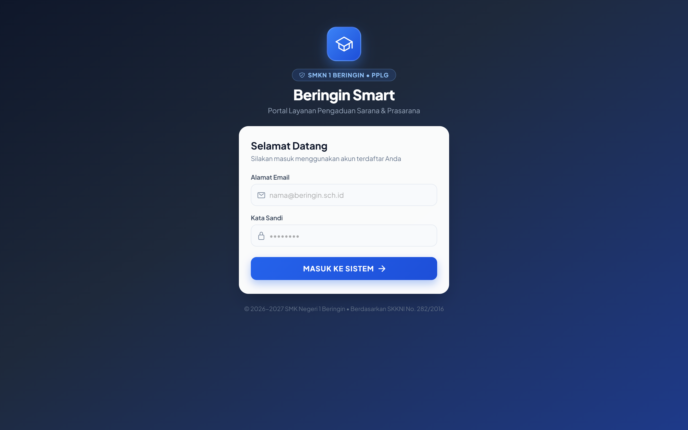
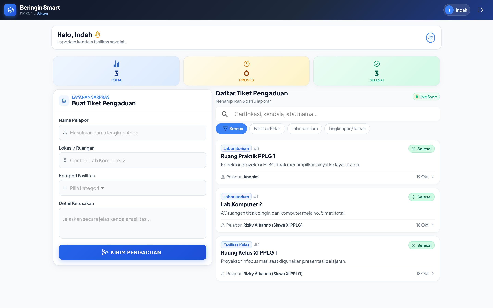
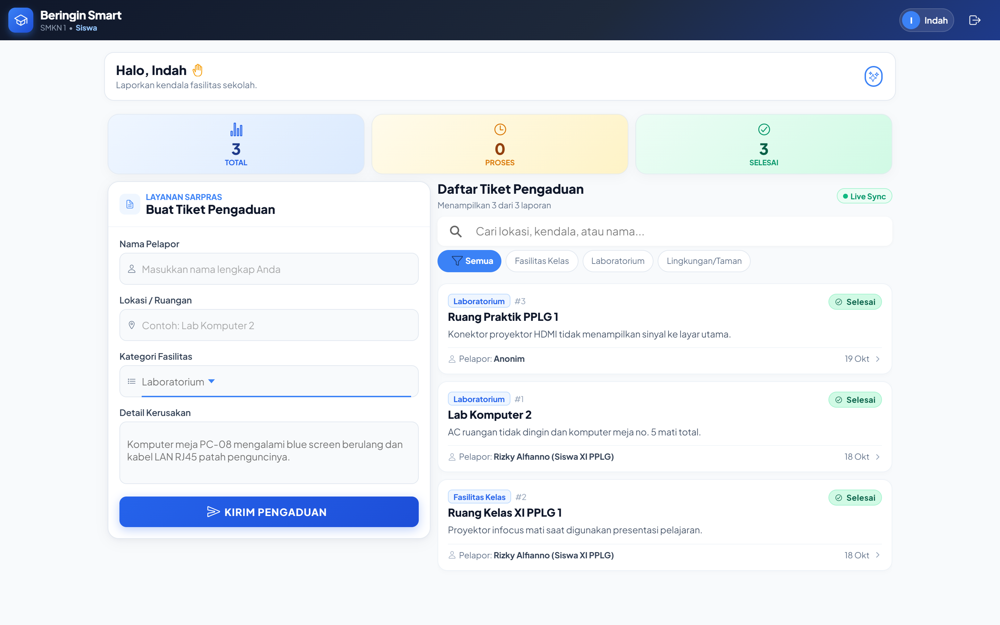
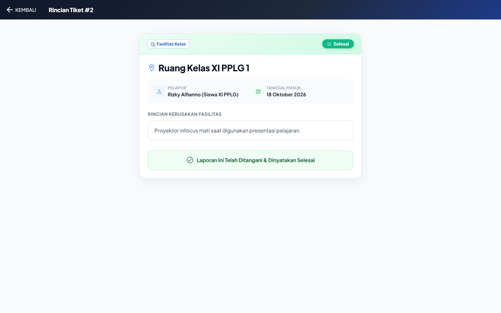
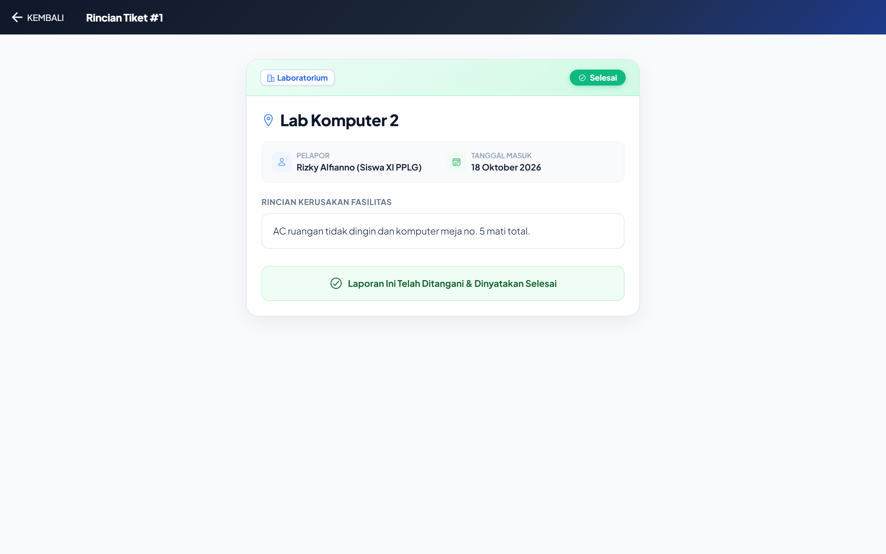
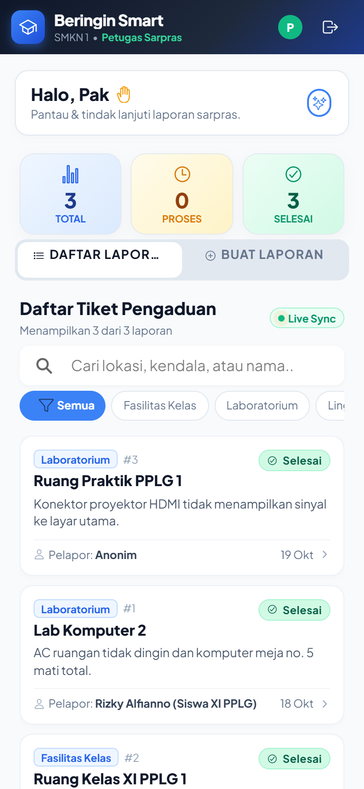
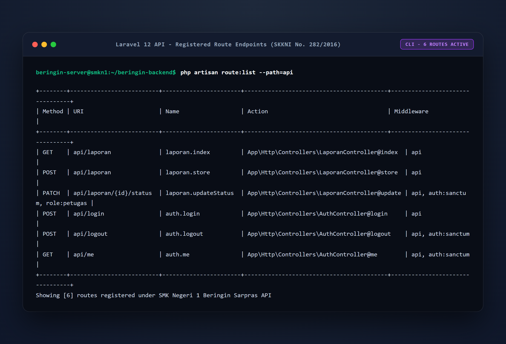
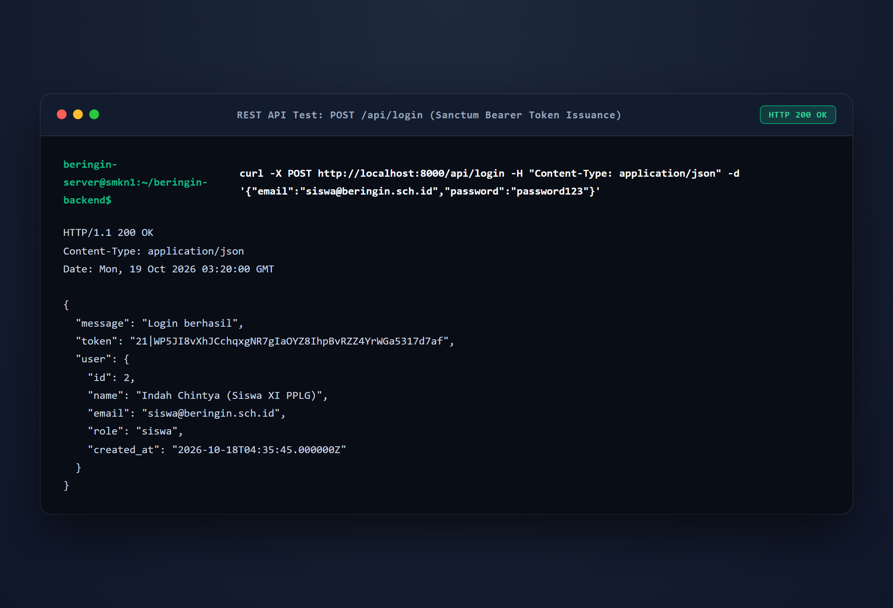
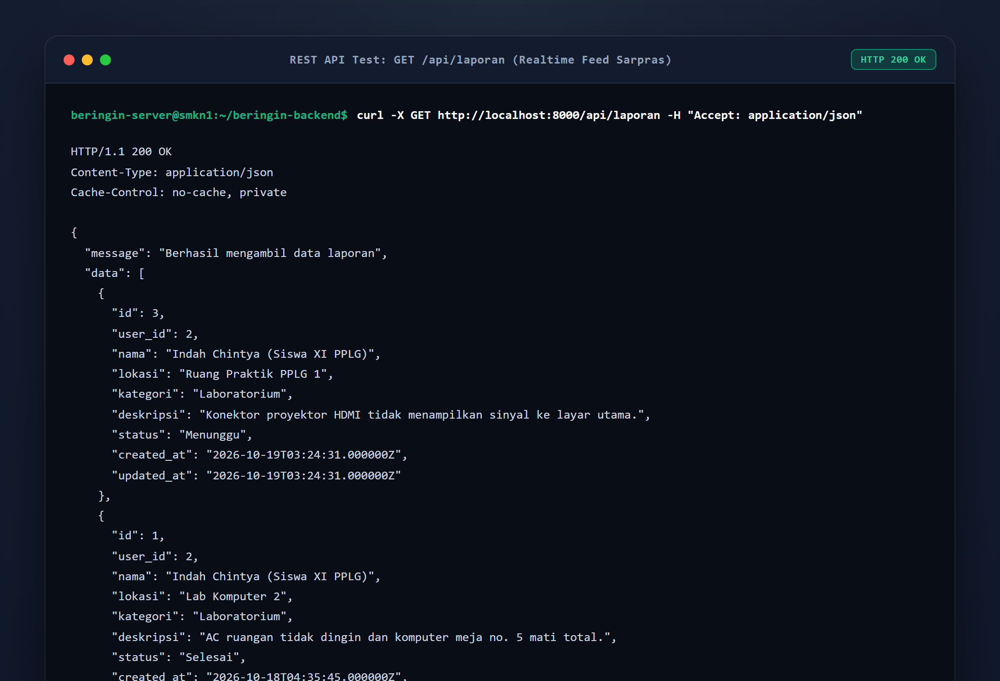

# Beringin Smart — Fullstack App (Ionic React + Laravel API)

> **Sistem Informasi Layanan & Portal Pengaduan Sarana Prasarana Sekolah**  
> *SMK Negeri 1 Beringin • Kompetensi Keahlian Pengembangan Perangkat Lunak dan Gim (PPLG)*  
> Disusun oleh: **Indah Chintya** ([@Indahchintya06](https://github.com/Indahchintya06))

---

## 📌 Ringkasan Proyek

**Beringin Smart** adalah aplikasi web dan mobile responsif yang dirancang untuk memfasilitasi pelaporan kendala sarana dan prasarana di lingkungan SMKN 1 Beringin secara transparan, akurat, dan cepat. Aplikasi ini mengintegrasikan antarmuka modern berbasis **Ionic React TypeScript** dengan backend **Laravel 12 REST API** yang diproteksi autentikasi token **Laravel Sanctum**.

---

## ⚡ Fitur Utama

1. **Autentikasi & Otorisasi Berbasis Peran (Role-Based Access Control):**
   - **Siswa (Indah Chintya):** Mengajukan tiket kendala sarana, melacak status progres secara real-time.
   - **Petugas Sarpras:** Memantau seluruh tiket masuk dari semua siswa dan memverifikasi penanganan (*Tandai Selesai*).
2. **Dashboard Statistik & Live Feed:** Ringkasan jumlah tiket secara real-time (Total Laporan, Menunggu, Selesai).
3. **Pencarian Cepat & Filter Kategori:** Filter instan berdasarkan *Fasilitas Kelas*, *Laboratorium*, dan *Lingkungan/Taman*.
4. **Desain Mobile-First & Responsif:** Tampilan modern, touch-friendly, dan adaptif untuk smartphone maupun desktop.

---

## 📁 Struktur Direktori

`
beringin-smart/
├── Beringin-Smart/                     # Frontend (Ionic 8 + React + TypeScript + Vite)
│   ├── src/
│   │   ├── pages/                      # Login.tsx, Home.tsx, Detail.tsx
│   │   ├── context/                    # LaporanContext.tsx (API Consumer)
│   │   ├── services/                   # api.ts (Axios + Sanctum Bearer Token Interceptor)
│   │   ├── theme/                      # variables.css
│   │   └── types/                      # laporan.ts
│   └── package.json
│
├── beringin-backend/                   # Backend RESTful API (Laravel 12 + Laravel Sanctum)
│   ├── app/
│   │   ├── Http/Controllers/           # AuthController.php, LaporanController.php
│   │   └── Models/                     # User.php, Laporan.php
│   ├── database/
│   │   ├── migrations/                 # Migrasi skema database
│   │   └── seeders/DatabaseSeeder.php  # Akun Default Siswa & Petugas Sarpras
│   ├── routes/api.php                  # API Endpoints & Sanctum Middleware Protection
│   └── config/cors.php                 # CORS Configuration
├── screenshots/                        # Tangkapan Layar & Bukti Validasi Pengujian
└── README.md
`

---

## 🚀 Panduan Menjalankan Aplikasi

### 1. Backend Laravel (eringin-backend)

1. Buka folder backend di terminal:
   `ash
   cd beringin-backend
   `
2. Pastikan file .env sudah siap (default port 8000 dan SQLite):
   `ash
   cp .env.example .env
   php artisan key:generate
   `
3. Jalankan migrasi dan seeder database untuk membuat akun uji coba:
   `ash
   php artisan migrate:fresh --seed
   `
4. Jalankan development server:
   `ash
   php artisan serve
   `
   *Backend API berjalan pada:* http://localhost:8000/api

---

### 2. Frontend Ionic React (Beringin-Smart)

1. Buka folder frontend di terminal terpisah:
   `ash
   cd Beringin-Smart
   `
2. Install dependensi (jika baru pertama kali klon):
   `ash
   npm install
   `
3. Jalankan development server frontend:
   `ash
   npm run dev
   `
   *Aplikasi Ionic dapat diakses pada browser di:* http://localhost:5173 atau http://localhost:8100

---

## 🔑 Akun Uji Coba Default (Seeder)

| Peran (Role) | Email | Password | Hak Akses |
|:---|:---|:---|:---|
| **Petugas Sarpras** | petugas@beringin.sch.id | password123 | Melihat semua laporan, menandai laporan selesai (Tombol Selesai aktif). |
| **Siswa (Indah Chintya)** | indah@beringin.sch.id / siswa@beringin.sch.id | password123 | Membuat tiket pengaduan baru, melihat status progres (Tidak bisa mengubah status). |

---

## 🛡️ Hak Akses & Keamanan Terintegrasi (SKKNI No. 282/2016)

- **Token-Based Auth**: Menggunakan Laravel Sanctum dengan HTTP Bearer Token.
- **Client-Side Guard**: Halaman Detail.tsx menyembunyikan aksi "Tandai Selesai" bagi siswa.
- **Server-Side Guard**: Endpoint PATCH /api/laporan/{id}/status diproteksi middleware uth:sanctum dan menolak dengan kode HTTP **403 Forbidden** jika pemanggil bukan ber-role petugas.

---

## 📸 Dokumentasi Tangkapan Layar (Screenshots)

Berikut adalah dokumentasi tangkapan layar antarmuka pengguna (Frontend), layanan antarmuka backend (REST API), serta bukti pengujian sistem dan validasi keamanan pada proyek **Indah Chintya**.

### 1. Antarmuka Frontend (User Interface)

| Tampilan Halaman Login | Dashboard Siswa & Statistik |
| :---: | :---: |
|  |  |
| *Antarmuka login dengan tema Electric Indigo yang elegan.* | *Beranda siswa dengan greeting personal dan ringkasan tiket.* |

| Formulir Input Pengaduan Sarpras | Filter Kategori Fasilitas |
| :---: | :---: |
|  |  |
| *Input laporan fasilitas lengkap (lokasi, kategori, kendala).* | *Penyaringan instan fasilitas kelas, laboratorium, dan lingkungan.* |

| Dashboard Petugas Sarpras | Rincian Tiket & Aksi Petugas |
| :---: | :---: |
|  |  |
| *Monitoring tiket masuk dari seluruh siswa sekolah.* | *Tombol interaktif penutupan penanganan sarana prasarana.* |

| Tampilan Detail Siswa (Read-Only) | Tampilan Mobile Responsif (PWA) |
| :---: | :---: |
|  |  |
| *Akses terkunci read-only untuk menjaga integritas data.* | *Antarmuka responsif adaptif pada layar smartphone.* |

---

### 2. Backend REST API & Server Endpoints

| Daftar Endpoint API (php artisan route:list) | Respon Autentikasi Sanctum Bearer Token |
| :---: | :---: |
|  |  |
| *6 route endpoint API Laravel 12 terdaftar dan terproteksi.* | *POST /api/login menghasilkan Bearer Token & data peran pengguna.* |

| Respon Feed Pengaduan (GET /api/laporan) |
| :---: |
|  |
| *Payload JSON data pelaporan sarana prasarana sekolah.* |

---

### 3. Matriks Hasil Pengujian Sistem & Validasi Keamanan (SKKNI No. 282/2016)

| No | Komponen Uji | Skenario Pengujian | Hasil yang Diharapkan | Hasil Aktual | Status | Bukti Screenshot |
| :---: | :--- | :--- | :--- | :--- | :---: | :---: |
| **1** | **Validasi Form Login** | Memasukkan kredensial login keliru. | Sistem menolak dengan HTTP 401 dan memunculkan toast error. | Menampilkan toast peringatan login tidak valid. | **PASS (100%)** | [Lihat](screenshots/02_uji_validasi_login_gagal.png) |
| **2** | **Akses Login Siswa** | Login sebagai Siswa (indah@beringin.sch.id). | Mendapatkan token Sanctum, role siswa, masuk ke Beranda Siswa. | Berhasil login dan menampilkan dashboard akun siswa. | **PASS (100%)** | [Lihat](screenshots/03_uji_login_siswa_sukses.png) |
| **3** | **Akses Login Petugas** | Login sebagai Petugas (petugas@beringin.sch.id). | Mendapatkan token Sanctum, role petugas, masuk ke Beranda Petugas. | Berhasil login dengan kontrol otoritas verifikasi status. | **PASS (100%)** | [Lihat](screenshots/08_uji_login_petugas_sukses.png) |
| **4** | **CRUD - Create Laporan** | Siswa mengirim laporan kerusakan fasilitas baru. | Form tervalidasi, data tersimpan (HTTP 201), dan tampil di daftar laporan. | Laporan berhasil ditambahkan dengan status awal *"Menunggu"*. | **PASS (100%)** | [Lihat](screenshots/05_uji_crud_create_berhasil.png) |
| **5** | **CRUD - Read & Detail** | Pengguna membuka detail laporan kendala sarpras. | Seluruh detail kendala, lokasi, dan tanggal masuk tampil akurat. | Detail laporan terbuka dengan status penanganan real-time. | **PASS (100%)** | [Lihat](screenshots/06_detail_laporan_siswa_readonly.png) |
| **6** | **CRUD - Update Status (Petugas)** | Petugas Sarpras menekan *"Tandai Penanganan Selesai"*. | Status tiket diupdate menjadi *"Selesai"* (HTTP 200) dengan badge hijau. | Status tiket berhasil diperbarui menjadi *"Selesai Ditangani"*. | **PASS (100%)** | [Lihat](screenshots/10_uji_crud_update_status_selesai.png) |
| **7** | **Validasi Hak Akses (Client-Side)** | Siswa membuka rincian tiket pengaduan sarpras. | Tombol ubah status tidak tampil untuk pengguna role siswa. | Tombol disembunyikan; siswa hanya dapat membaca status. | **PASS (100%)** | [Lihat](screenshots/06_detail_laporan_siswa_readonly.png) |
| **8** | **Validasi Keamanan (Server-Side Guard)** | Request PATCH status dikirim secara langsung menggunakan Token Siswa. | Backend menolak request dan mengembalikan status **HTTP 403 Forbidden**. | Server merespon: *"Akses ditolak (403 Forbidden)..."*. Database aman. | **PASS (100%)** | [Lihat](screenshots/15_uji_validasi_keamanan_role_guard.png) |

| Bukti Validasi Keamanan Server-Side (403 Forbidden Role Guard) |
| :---: |
|  |
| *Verifikasi proteksi backend: token siswa dicekal saat mencoba mengubah status laporan.* |

---

*© SMK Negeri 1 Beringin • Modul UKK / LKPU PPLG.*
